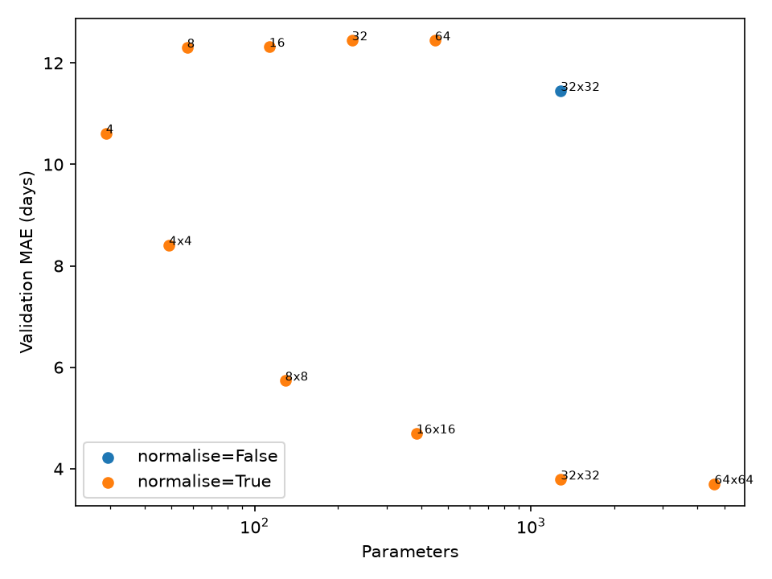
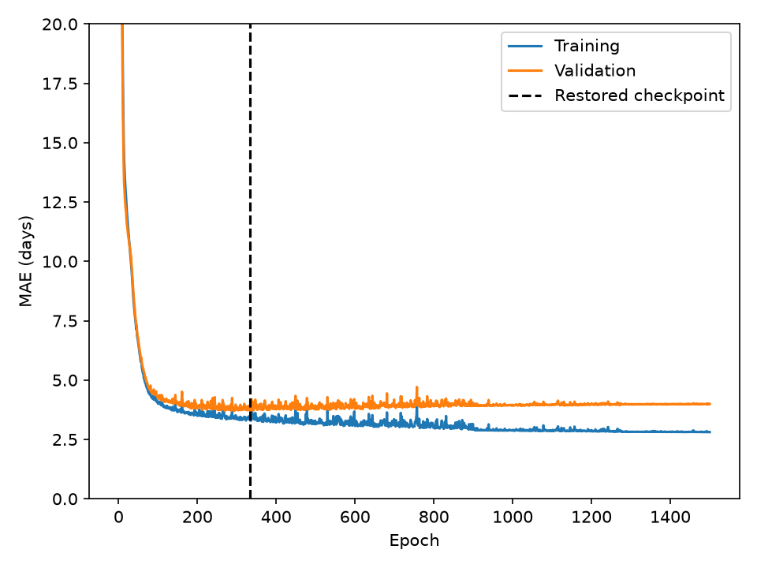
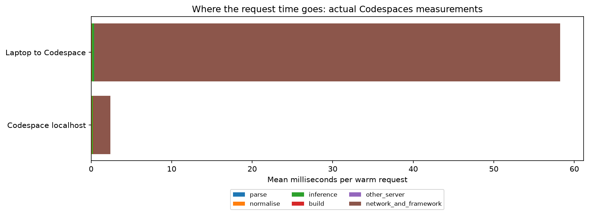

# How Long Will the Battery Last? - Team 4, EdgeX

A small neural network predicts the remaining battery life of a doorbell from five sensor and usage readings. The trained PyTorch model is served through FastAPI in GitHub Codespaces.

**[Try predictions in Swagger](https://redesigned-eureka-x5gq4qgxj4g92px76-8000.app.github.dev/docs) | [Health](https://redesigned-eureka-x5gq4qgxj4g92px76-8000.app.github.dev/health) | [Model information](https://redesigned-eureka-x5gq4qgxj4g92px76-8000.app.github.dev/model_info) | [Submission details](SUBMISSION.md)**

## Submission links and status

| Item | Value |
|---|---|
| Team | 4 - EdgeX |
| Members listed in the instructor's TEAMS.csv | Swayam Goyal, Yash Bhalotia, Yash Purwar, Priyanshi Gupta |
| Repository | [YashP001/EdgeAI](https://github.com/YashP001/EdgeAI) |
| API base address to submit | [Battery prediction API](https://redesigned-eureka-x5gq4qgxj4g92px76-8000.app.github.dev) |
| Selected network | 5 -> 64 -> 64 -> 1, ReLU hidden activations |
| Validation MAE | **3.7005 days** |
| Training MAE | **3.3013 days** |
| Parameters | **4,609** |
| Dataset | Only `data/team_04_train.csv`; all **2,000 rows retained unchanged** |
| Split | 1,600 training rows / 400 validation rows, seed 0 |
| Public verification | Passed on **19 November 2026** |
| Deadline | **Monday, 23 November 2026** |

The base address is an API prefix, so opening `/` returns HTTP 404 (`{"detail":"Not Found"}`). This does not mean the service is offline. Open **`/docs`** for the browser interface or **`/health`** to check it. The instructor's script appends the required API paths to the base address.

The endpoint is hosted in a Codespace, not on permanent hosting. It remains available only while the Codespace and server are running and port 8000 is Public. The instructor's submission channel and grading-window time were not supplied.

**Documented deviation from the instructor's instructions:** the original assignment asks for removing sensor glitches. At the team's explicit request, this implementation removes **zero rows**. It flags unusual historical readings for audit and retains them across the training/validation split. Incoming API requests are still validated and broken readings are rejected. This exception should be discussed with the instructor before submission.

The original instructor README is preserved separately, unchanged, in [INSTRUCTOR_README.md](INSTRUCTOR_README.md). This README describes the work actually performed. [ASSIGNMENT_RESULTS.md](ASSIGNMENT_RESULTS.md) contains the measured results, and [TEAM_GUIDE.md](TEAM_GUIDE.md) explains the implementation for team review.

## What was implemented

- Audited only Team 4's CSV, counted missing/nonfinite and impossible readings, and preserved the original data byte-for-byte.
- Plotted every column's histogram and `days_left` against each input.
- Measured the mean baseline and a linear-regression baseline fitted with `np.linalg.lstsq`; plotted predictions against actual values and recorded the worst errors.
- Ran the original instructor starter unchanged in an isolated temporary directory, keeping its outputs separate from the submission model.
- Implemented training-only input normalisation and compared it with unnormalised training.
- Trained widths 4, 8, 16, 32 and 64 with one and two hidden layers; saved full learning histories and the MAE-versus-parameter plot.
- Selected and saved the best validation checkpoint, with its feature order, normalisation statistics, team number and metrics.
- Implemented all four required API routes, physical operating-range assumptions, five timing fields, and single/batch prediction handling.
- Computed per-layer parameters, float32 bytes, MACs, theoretical int8 storage and memory-fit flags directly from the actual network.
- Created and started the repository's Codespace, started Uvicorn, published port 8000 and verified the API without authentication.
- Ran the unchanged benchmark client from Windows and inside Codespaces, with and without connection reuse; saved first-request timings, every stage's p50/p95/p99 and raw CSVs.
- Compared 400 single requests with one 400-row batch locally and remotely; additionally verified exact single/batch equality for 50 public readings.
- Tested three glitches and a valid reading through Swagger; ran a final public 50-request benchmark.
- Produced the ESP32 memory-width table, exact SRAM thresholds, activation-buffer estimate, a sourced board-time estimate, and a cloud-versus-device discussion.
- Committed the model, code, plots, checks and measurements to GitHub. Nine automated tests passed, alongside checks against the real deployed model.

## Run or restart the API

### GitHub Codespaces

Open the existing [redesigned eureka Codespace](https://redesigned-eureka-x5gq4qgxj4g92px76.github.dev/), or create a Codespace from this repository. The supplied `.devcontainer/devcontainer.json` is unchanged and installs the requirements on creation.

From the repository directory:

```sh
git pull --ff-only
pip install -r requirements.txt
bash tools/start_codespace.sh
```

The startup script loads the committed model and runs:

```sh
python -m uvicorn app.main:app --host 0.0.0.0 --port 8000
```

In **Ports**, right-click **8000** and set **Port Visibility -> Public**. The public address is currently the one linked above. A new Codespace will have a different address. Check visibility again after every restart. If GitHub CLI is installed and authorised, the port can also be published from a second Codespace terminal:

```sh
gh codespace ports visibility 8000:public -c "$CODESPACE_NAME"
```

Do not start a second server on port 8000 while one is already running. Use a second terminal for benchmarks, leaving the server terminal running.

### Local development

Create and activate a Python virtual environment, then run:

```sh
pip install -r requirements.txt
python -m uvicorn app.main:app --host 127.0.0.1 --port 8000
```

Open [local Swagger](http://127.0.0.1:8000/docs). Localhost is for local testing and is not the endpoint to submit. Training is unnecessary just to serve the committed model.

## Train and reproduce the experiments

```sh
python train.py --team 4 --sweep --epochs 1500
```

This uses only Team 4's CSV and runs ten normalised architectures plus the unnormalised 32,32 comparison on the same split. It overwrites `model/model.pt` and `model/config.json` with the selected normalised model. To train one chosen architecture:

```sh
python train.py --team 4 --hidden 64,64 --epochs 1500
```

Training uses minibatches of 128, MSE loss, Adam with initial learning rate 0.003, and a learning-rate schedule that reduces the rate later in training. Each run restores the checkpoint with the lowest validation MAE. MSE is the optimisation loss; MAE, measured in days, is the reported evaluation metric.

For each input feature, normalisation is `(value - training_mean) / training_standard_deviation`. These statistics come only from training rows to avoid leaking validation information. Zero-variance features use a safe scale of one. The server uses the saved feature order and the same means and scales.

The original-starter comparison can be reproduced with the instructor ZIP:

```sh
python tools/run_original_starter.py --archive /path/to/edge_ai_assignment1.zip --team 4
```

This extracts only the required starter files and Team 4 CSV into a temporary directory, runs the original source, and saves its log and config separately. It does not overwrite the final model. CPU thread counts are constrained for execution; the original trainer's source is unchanged.

Seeds and the split are fixed, but exact numerical results can vary with platform and library versions. The measured local environment is recorded in `results/team_04/environment.json`; the Codespace environment is recorded in `results/team_04/benchmarks/codespace_environment.json`.

## API contract and examples

| Method and path | Purpose |
|---|---|
| `GET /health` | Status, team, parameter count and saved validation MAE |
| `GET /model_info` | Actual network's layers, parameter storage, MACs and memory-fit flags |
| `POST /predict` | One reading, one predicted number of days, stage timings |
| `POST /predict_batch` | Between 1 and 10,000 readings, a list of predictions, stage timings |
| `GET /docs` | Interactive Swagger interface for trying the API |

### Health

```json
{"status": "ok", "team": 4, "params": 4609, "val_mae": 3.7005}
```

### One reading

Request body for `POST /predict`:

```json
{
  "battery_v": 3.86,
  "temp_c": 28,
  "rings_per_day": 5,
  "wifi_rssi_dbm": -66,
  "age_months": 22
}
```

This example returned the following during the deployed Swagger check. Prediction values are in days; timing values are milliseconds and vary on each request.

```json
{
  "days_left": 111.18,
  "timings_ms": {
    "parse": 0.046918,
    "normalise": 0.046056,
    "inference": 0.269383,
    "build": 0.019376,
    "server_total": 0.397102
  }
}
```

### Batch

Request body for `POST /predict_batch`:

```json
{
  "rows": [
    {
      "battery_v": 3.86,
      "temp_c": 28,
      "rings_per_day": 5,
      "wifi_rssi_dbm": -66,
      "age_months": 22
    }
  ]
}
```

The response has a `days_left` list and the same five timing fields. One invalid row rejects the entire batch. Predictions are clipped to a minimum of zero days and rounded to two decimal places. Float32 batch and single arithmetic can differ slightly in general; all 50 readings in the additional public check matched exactly.

### Input validation

| Feature | Accepted range | Units / assumption |
|---|---|---|
| `battery_v` | Greater than 0, at most 5 | Volts, single-cell doorbell operating assumption |
| `temp_c` | -40 to 85 inclusive | Degrees Celsius |
| `rings_per_day` | 0 to 86,400 inclusive | At most one recorded event per second |
| `wifi_rssi_dbm` | At least -127 and less than 0 | dBm; zero is treated as a sensor sentinel |
| `age_months` | 0 to 600 inclusive | Months, up to 50 years |

These are conservative operating assumptions, not limits learned from the CSV and not manufacturer-certified specifications. The API also rejects missing fields, unknown fields, nonfinite values and malformed JSON. Invalid readings return HTTP 422 with a reason, rather than a prediction. Historical sensor sentinels remain in the training/validation data at the team's request.

### Timing boundaries

| Timing field | What is included |
|---|---|
| `parse` | Reading and validating the request body |
| `normalise` | Building the ordered feature array and scaling the inputs |
| `inference` | PyTorch forward pass with gradients disabled |
| `build` | Converting, clipping and rounding predictions for the response |
| `server_total` | The server handler's elapsed time before FastAPI response serialization |

Round trip minus `server_total` includes framework, serialization, routing and network time; it is not a pure network-latency measurement. Independently calculated stage medians do not necessarily sum to a median total, so the additive timing plot uses means.

## Data and baselines

The audit found 10 zero-voltage readings, 5 readings at the impossible temperature sentinel, and 9 zero-RSSI readings. All 24 flagged rows remain in the dataset. There were no missing/nonfinite values.

All 2,000 original rows were retained: 1,600 training and 400 validation. The CSV is byte-for-byte unchanged. The audit flags 24 sensor sentinel readings, but removes zero rows at the team's request. This intentionally differs from the README instruction to remove glitches. API validation still rejects broken incoming readings.

| Model | Validation MAE (days) |
|---|---:|
| Mean baseline | 42.6824 |
| Linear least squares | 25.8684 |
| Original instructor starter, unchanged | 9.12 |

The original starter was run separately using the instructor ZIP and this team's CSV. It did not overwrite the submission model. The controlled sweep below uses a learning-rate schedule and restores each run's best validation checkpoint, so its unnormalised run is a separate experiment.

The relationships plot shows strong voltage curvature and declining battery life as ringing frequency increases. Linear regression misses high-life readings most severely: CSV row 1505 has 225.8 actual days versus 118.48 predicted days, a 107.32-day error. The ten largest errors are recorded in linear_worst_errors.csv.

## Architecture and normalisation comparisons

| Hidden layers | Normalised | Parameters | Training MAE | Validation MAE | Best epoch |
|---|---|---:|---:|---:|---:|
| 32 -> 32 | False | 1281 | 10.5283 | 11.4502 | 1116 |
| 4 | True | 29 | 10.6454 | 10.6126 | 614 |
| 4 -> 4 | True | 49 | 8.5326 | 8.4106 | 1493 |
| 8 | True | 57 | 13.5197 | 12.3043 | 465 |
| 8 -> 8 | True | 129 | 5.2124 | 5.7368 | 1499 |
| 16 | True | 113 | 13.4358 | 12.3196 | 352 |
| 16 -> 16 | True | 385 | 4.1764 | 4.6966 | 1274 |
| 32 | True | 225 | 13.3646 | 12.4474 | 464 |
| 32 -> 32 | True | 1281 | 3.3948 | 3.7864 | 1465 |
| 64 | True | 449 | 13.3265 | 12.4447 | 412 |
| 64 -> 64 | True | 4609 | 3.3013 | 3.7005 | 334 |

The saved model is 5 -> 64 -> 64 -> 1, restored from epoch 334. Its training MAE is 3.3013 days and validation MAE is 3.7005 days. Later epochs reduce training error while validation worsens; the earlier checkpoint limits overfitting. Normalisation statistics use training rows only. Validation selected both architecture and checkpoint; the hidden-test error is unknown. A provisional forecast is about 4 days MAE.

## Per-layer memory and work

| Layer | Parameters | Float32 bytes | MACs |
|---|---:|---:|---:|
| 5 -> 64 | 384 | 1536 | 320 |
| 64 -> 64 | 4160 | 16640 | 4096 |
| 64 -> 1 | 65 | 260 | 64 |
| Total | 4609 | 18436 | 4480 |

Each dense layer has input_width * output_width weights plus output_width biases. Each connection costs one MAC by the assignment convention. The starter 5 -> 32 -> 32 -> 1 counts are 192 + 1056 + 33 = 1281 parameters, 5124 float32 bytes and 1216 MACs.

## Request timing

All modes used the supplied, unchanged client/bench.py with 200 requests. The first request is separate; p50/p95/p99 exclude it. These first requests follow a health request and are not fresh-process cold-start measurements.

| Mode | First request ms | Round trip p50 | p95 | p99 | Inference p50 | Server total p50 |
|---|---:|---:|---:|---:|---:|---:|
| Windows localhost, keepalive | 5.050 | 3.231 | 4.129 | 4.751 | 0.329 | 0.506 |
| Windows localhost, no keepalive | 5.757 | 4.480 | 6.826 | 22.046 | 0.322 | 0.499 |
| Codespace localhost, keepalive | 95.441 | 2.186 | 3.994 | 6.158 | 0.137 | 0.245 |
| Codespace localhost, no keepalive | 8.285 | 2.665 | 4.028 | 7.280 | 0.132 | 0.223 |
| Laptop to Codespace, keepalive | 620.969 | 53.791 | 80.510 | 160.991 | 0.236 | 0.379 |
| Laptop to Codespace, no keepalive | 544.290 | 507.940 | 882.613 | 1355.453 | 0.224 | 0.373 |

### Public keepalive timing by stage

All values below are milliseconds, excluding the first prediction request.

| Stage | p50 | p95 | p99 |
|---|---:|---:|---:|
| `round_trip` | 53.791 | 80.510 | 160.991 |
| `parse` | 0.046 | 0.075 | 0.088 |
| `normalise` | 0.047 | 0.059 | 0.088 |
| `inference` | 0.236 | 0.312 | 0.467 |
| `build` | 0.021 | 0.030 | 0.055 |
| `server_total` | 0.379 | 0.466 | 0.770 |
| `network_and_framework` | 53.440 | 80.060 | 160.583 |

All six modes' full stage percentiles are in [comparison.json](results/team_04/benchmarks/comparison.json).

Every stage's p50/p95/p99 and all raw requests are preserved in benchmarks/comparison.json and the per-mode CSVs. Network plus framework is round trip minus server_total; it includes response serialization and routing overhead as well as transport.

The LLM forecast was that transport/HTTP would dominate remote inference, with 0.1-1 ms inference and 50-300 ms remote round trip. Compare those guesses with the measured percentiles above. Connection reuse avoids reconnecting and TLS setup for every remote request. Localhost omits the internet/TLS tunnel but still includes HTTP and framework work. The first inside-Codespace inference took 89.516 ms, versus 0.137 ms at the warm median, showing one-time forward-path overhead. The first remote prediction used a new HTTP session and took 621.0 ms even after the model had warmed up. Different machines and run conditions also affect results; these comparisons do not isolate hardware speed alone.

| Location | 400 single calls ms | One 400-row batch ms | Speedup |
|---|---:|---:|---:|
| Windows localhost | 1197.981 | 7.317 | 163.7x |
| Codespace localhost | 1045.805 | 26.358 | 39.7x |
| Laptop to Codespace | 28181.321 | 109.747 | 256.8x |

Batching amortises HTTP/tunnel overhead and uses one array and network call for many readings. The generated readings in these checks test API behaviour, not predictive accuracy. A separate 50-reading public batch check matched all 50 single predictions exactly (maximum difference 0 days). Three invalid readings were also tried directly in Swagger and all returned 422; a valid reading returned 200. A final 50-request public benchmark passed.

## Doorbell memory budget

Memory budgets use 300 * 1024 SRAM bytes and 8 * 1024 * 1024 PSRAM bytes. The flags concern parameter storage. Runtime allocations, stack and scratch space also need memory. Int8 is a theoretical one-byte-per-parameter estimate; no quantised model has been exported or accuracy-tested.

| Width w in 5 -> w -> w -> 1 | Parameters | Float32 bytes | Int8 bytes | SRAM f32 | SRAM int8 | PSRAM f32 | PSRAM int8 | MACs |
|---|---:|---:|---:|---|---|---|---|---:|
| 32 | 1281 | 5124 | 1281 | True | True | True | True | 1216 |
| 128 | 17409 | 69636 | 17409 | True | True | True | True | 17152 |
| 256 | 67585 | 270340 | 67585 | True | True | True | True | 67072 |
| 512 | 266241 | 1064964 | 266241 | False | True | True | True | 265216 |
| 2048 | 4210689 | 16842756 | 4210689 | False | False | False | True | 4206592 |

P(w) = w*w + 8*w + 1. Float32: w=273 uses 306856 bytes and fits, while w=274 uses 309076 bytes and fails. Int8: w=550 uses 306901 bytes and fits, while w=551 uses 308010 bytes and fails. Thus the first failing widths are 274 and 551.

The selected model uses 18436 float32 parameter bytes (4609 theoretical int8 bytes), and at most 128 simultaneous dense-layer input/output activation values: 512 float32 bytes or 128 int8 bytes. It fits the stated SRAM budget by a wide margin before runtime overhead.

At an assumed conservative 10 million MAC/s, 4480 MACs take 0.448 ms of compute. This is an estimate, not an ESP32 measurement. Espressif's [ESP-NN benchmark](https://github.com/espressif/esp-nn/blob/master/docs/performance.md) lists a 271-by-3 int8 fully connected kernel at 8439 ANSI C cycles or 1543 optimised cycles at 240 MHz, about 23 or 126 million MAC/s for that shape. The lower assumption leaves margin; it is not a measured or guaranteed rate for this model, float32 code, preprocessing or invocation overhead.

On-device inference is a reasonable production direction: it avoids remote latency and per-request cloud costs, keeps readings local, and works when Wi-Fi is down. It also avoids a radio transmission for each prediction, although net energy savings require board measurements. Cloud inference simplifies updates and central monitoring. The public cloud endpoint is still required for this assignment.

## Verification and benchmark commands

Install development dependencies and run the automated contract and synthetic-training checks:

```sh
pip install -r requirements-dev.txt
python -m unittest discover -s tests -v
```

**Nine tests passed.** These include model-count arithmetic, health/info consistency, required timing fields, invalid readings for all five fields, zero sensor sentinels, malformed/missing/nonfinite inputs, batch bounds, plausible readings outside the benchmark ranges, synthetic learning, and preservation of every source row and source bytes. Contract tests use a temporary random model; the real trained model was checked separately against running local and public APIs.

Run the real endpoint checker from a laptop:

```sh
python client/verify.py --url https://redesigned-eureka-x5gq4qgxj4g92px76-8000.app.github.dev --team 4 --output results/team_04/public_endpoint_check.json
```

Run the instructor's benchmark without changing `client/bench.py`:

```sh
python client/bench.py --url https://redesigned-eureka-x5gq4qgxj4g92px76-8000.app.github.dev --n 200
python client/bench.py --url https://redesigned-eureka-x5gq4qgxj4g92px76-8000.app.github.dev --n 200 --no-keepalive
```

Inside Codespaces, in a second terminal:

```sh
python tools/run_codespace_checks.py
```

The helper runs both 200-request localhost modes and the real endpoint checker, preserving each mode's output in a separate directory. `client/verify.py` compares 400 single predictions with one batch, checks layer arithmetic and timing fields, and rejects five broken readings. Its generated readings test behaviour, not hidden-test accuracy.

Generate hardware tables and summarise the saved measurements:

```sh
python tools/hardware.py
python tools/summarise_results.py
```

The hardware helper and `/model_info` share the same counting function. The summary helper reads saved results without retraining or changing source data. Benchmark filenames have one-second timestamp resolution; use separate directories when preserving different runs.

The final pre-submission check was also run successfully:

```sh
python client/bench.py --url https://redesigned-eureka-x5gq4qgxj4g92px76-8000.app.github.dev --n 50
```

## Repository and evidence map

| Path | What it contains |
|---|---|
| `INSTRUCTOR_README.md` | Original instructor instructions, preserved unchanged |
| `TEAMS.csv` | Original team listing |
| `data/team_04_train.csv` | Unmodified Team 4 source data |
| `train.py` | Row audit, deterministic split, baselines, plots, normalisation, experiments and model saving |
| `app/model.py` | Shared dense/ReLU network and ordered feature names |
| `app/validation.py` | Shared operating-range assumptions |
| `app/metrics.py` | Counts layers, parameters, bytes, MACs, activation buffers and memory flags |
| `app/main.py` | Saved-model loading, FastAPI routes, validation, timing and inference |
| `model/model.pt` | Selected trained model weights, committed |
| `model/config.json` | Team, architecture, feature order, means, scales, metrics, checkpoint epoch and data hash |
| `client/bench.py` | Instructor's original benchmark client, unchanged |
| `client/verify.py` | Actual endpoint contract and single-versus-batch checker |
| `tests/` | Automated API, model-count, synthetic-learning and row-preservation checks |
| `tools/start_codespace.sh` | Starts the committed model's server |
| `tools/run_original_starter.py` | Runs the original trainer in isolation |
| `tools/run_codespace_checks.py` | Collects in-Codespace measurements |
| `tools/hardware.py` | Width table, exact SRAM thresholds and assumed-speed compute estimates |
| `tools/summarise_results.py` | Rebuilds the measured-results summary and timing comparison plot |
| `results/team_04/cleaning.json` | Audit counts and explicit zero-removal policy |
| `results/team_04/row_audit.csv` | Flags mapped to original CSV row numbers |
| `results/team_04/data_integrity.json` | Original CSV SHA256 and zero-removal evidence |
| `results/team_04/protected_files_integrity.json` | Byte comparisons with the original ZIP for the Team 4 CSV, benchmark and devcontainer |
| `results/team_04/forecasts.txt` | Pre-experiment LLM estimates, clearly labelled |
| `results/team_04/baselines.json` | Mean and linear baseline measurements |
| `results/team_04/linear_worst_errors.csv` | Ten largest linear validation errors, with inputs and original row numbers |
| `results/team_04/original_starter/` | Original trainer reference, log and measured config |
| `results/team_04/experiments.csv` and `history_*.csv` | Architecture comparison and per-epoch learning histories |
| `results/team_04/summary.json` | Dataset audit, baselines, experiments and selected result |
| `results/team_04/model_info.json` | Saved final network's parameter and memory table |
| `results/team_04/benchmarks/` | Raw benchmark CSVs, text summaries, environment, full percentiles and timing diagrams |
| `results/team_04/*endpoint_check.json` | Actual Windows, Codespace and public API check results |
| `results/team_04/public_batch_50_check.json` | Exact equality evidence for 50 public single/batch predictions |
| `results/team_04/swagger_checks.json` | Three Swagger 422 checks and one valid 200 response |
| `results/team_04/public_health.jpg` | Public health response screenshot |
| `results/hardware/` | Requested width table and first failing SRAM widths |
| `ASSIGNMENT_RESULTS.md` | Consolidated measured results and interpretations |
| `TEAM_GUIDE.md` | Code walkthrough and concepts for team review |
| `VERIFICATION.md` | Completed verification record |
| `SUBMISSION.md` | Submission links, restart instructions and grading-window requirements |

Plots are saved under `results/team_04/`: `histograms_all_rows.png`, `relationships.png`, `linear_predictions.png`, `network_predictions.png`, `mae_vs_parameters.png`, `selected_learning_curve.png`, and the local/remote timing breakdowns under `benchmarks/`.

### Selected plots







## Suggested team demonstration

1. Open `/health` and explain team 4, the 4,609 parameter count and the saved 3.7005-day validation MAE.
2. Open `/docs`, expand `POST /predict`, select **Try it out**, paste the valid example above and execute it. Explain the prediction and timing fields.
3. Change one input at a time to `battery_v=-1`, `temp_c=-273` and `rings_per_day=-1`. Show HTTP 422 and the field-specific reason. Restore the valid reading afterwards.
4. Open `/model_info` and explain how each dense layer's parameters, bytes and MACs are counted from the real network.
5. Use `/predict_batch` with multiple readings and explain why its output is a list. Show the exact 50-reading single/batch check result.
6. Show the baseline comparison, MAE-versus-parameters plot and selected learning curve. Distinguish training error, validation error and the unknown instructor hidden-test error.
7. Show the remote/localhost timing comparison and explain connection reuse and batching. Show the hardware table and distinguish memory estimates from actual board measurements.

The instructor requires an endpoint and repository link, not a separate report or viva. This sequence is for team understanding and an optional demonstration.

## Limitations and human follow-up

- The glitch-removal instruction was intentionally not followed because the team explicitly requested retaining all rows. The exception is visible in the audit and should be confirmed with the instructor.
- Validation was used to choose both checkpoint and architecture. Its MAE can be optimistic; the instructor's hidden-test MAE has not been measured.
- The model estimates remaining life from the supplied data; it does not guarantee a particular physical battery's lifetime. Extreme but accepted inputs can fall outside the observed training distribution.
- Input bounds are engineering assumptions because no hardware-specific sensor datasheet was supplied.
- Int8 storage and ESP32 compute time are estimates. No quantised model, firmware deployment, actual board latency or board energy usage was tested.
- The endpoint was verified on 19 November 2026. Its continued availability depends on the Codespace remaining running, Uvicorn staying active and port 8000 remaining Public. Recheck all three during the announced grading window.
- Everyone should review and understand the code and rotate the Builder, Measurer, Skeptic and Scribe roles. This documentation does not claim those human activities were performed.
- Add the other team members as GitHub collaborators using their usernames. No collaborator invitations were sent because their usernames were not supplied.
- Submit the two links using the instructor's announced channel by Monday, 23 November 2026. The channel and check-window time remain to be announced in the supplied instructions.
- The implementation is AI-assisted. Forecasts are labelled LLM estimates; measurements come from saved runs. Review the original instructor's LLM-use rule in [INSTRUCTOR_README.md](INSTRUCTOR_README.md) and ensure the team's use and submission comply with the instructor's expectations.
